<p>
  <a href="mailto:ronaldajusan0@gmail.com"><picture><source media="(prefers-color-scheme: dark)" srcset="assets/contact-email-dark.svg" /></picture></a>
  <a href="https://www.linkedin.com/in/ronald-ajusan-251109371"><picture><source media="(prefers-color-scheme: dark)" srcset="assets/contact-linkedin-dark.svg" /></picture></a>
  <a href="https://www.facebook.com/ronaldong.ajusan"><picture><source media="(prefers-color-scheme: dark)" srcset="assets/contact-facebook-dark.svg" /></picture></a>
  <a href="https://www.tiktok.com/@ronaldajusan"><picture><source media="(prefers-color-scheme: dark)" srcset="assets/contact-tiktok-dark.svg" /></picture></a>
</p>

I'm a fourth-year BS Information Technology student at the Technological University of the Philippines Taguig. I build full-stack web apps, write and automate the tests for them, and work on payment systems on the Stellar network.

I'm the lead developer of HeyPay, a funded Stellar-to-QRPH payment platform, under contract with Artisam Labs, where I also interned in QA testing Web3 products. On the side I built and maintain the booking platform for Trixélle Nail Studio, and I shoot and edit short-form video.

## Projects

<p>
  <a href="(https://github.com/artisam-heypay/heypay)"><picture><source media="(prefers-color-scheme: dark)" srcset="assets/card-heypay-dark.svg" /></picture></a>
  <a href="https://trixellenailstudio.com"><picture><source media="(prefers-color-scheme: dark)" srcset="assets/card-trixelle-dark.svg" /></picture></a>
  <a href="https://app-dev-blockchain-project.vercel.app"><picture><source media="(prefers-color-scheme: dark)" srcset="assets/card-bayanihan-dark.svg" /></picture></a>
  <picture><source media="(prefers-color-scheme: dark)" srcset="assets/card-research-dark.svg" /></picture>
</p>

### See them live

Swipe or scroll sideways. Each window scrolls through the real site.

<table>
  <tr>
    <td valign="top"><a href="https://heypayfi.xyz">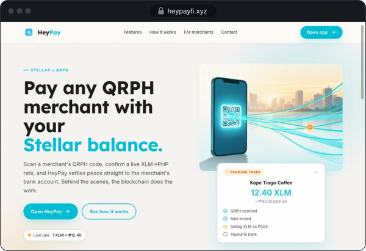</a><br /><sub>HeyPay&nbsp;·&nbsp;landing&nbsp;page&nbsp;&nbsp;&nbsp;&nbsp;&nbsp;&nbsp;&nbsp;&nbsp;&nbsp;&nbsp;&nbsp;&nbsp;&nbsp;&nbsp;&nbsp;&nbsp;&nbsp;&nbsp;&nbsp;&nbsp;&nbsp;&nbsp;&nbsp;&nbsp;&nbsp;&nbsp;&nbsp;&nbsp;&nbsp;&nbsp;&nbsp;&nbsp;&nbsp;&nbsp;&nbsp;&nbsp;&nbsp;&nbsp;&nbsp;&nbsp;&nbsp;&nbsp;&nbsp;&nbsp;&nbsp;&nbsp;&nbsp;&nbsp;&nbsp;&nbsp;&nbsp;&nbsp;&nbsp;&nbsp;&nbsp;&nbsp;&nbsp;&nbsp;&nbsp;&nbsp;&nbsp;&nbsp;&nbsp;&nbsp;&nbsp;&nbsp;&nbsp;&nbsp;&nbsp;&nbsp;&nbsp;&nbsp;&nbsp;&nbsp;&nbsp;&nbsp;&nbsp;&nbsp;&nbsp;&nbsp;&nbsp;&nbsp;&nbsp;&nbsp;&nbsp;&nbsp;&nbsp;&nbsp;&nbsp;&nbsp;&nbsp;&nbsp;&nbsp;&nbsp;&nbsp;&nbsp;&nbsp;&nbsp;&nbsp;&nbsp;&nbsp;&nbsp;&nbsp;&nbsp;&nbsp;&nbsp;&nbsp;&nbsp;&nbsp;&nbsp;&nbsp;&nbsp;&nbsp;&nbsp;&nbsp;&nbsp;&nbsp;&nbsp;&nbsp;&nbsp;&nbsp;&nbsp;&nbsp;&nbsp;&nbsp;&nbsp;&nbsp;&nbsp;&nbsp;&nbsp;&nbsp;&nbsp;&nbsp;&nbsp;&nbsp;&nbsp;&nbsp;&nbsp;&nbsp;&nbsp;&nbsp;&nbsp;&nbsp;&nbsp;&nbsp;&nbsp;&nbsp;&nbsp;&nbsp;&nbsp;&nbsp;&nbsp;&nbsp;&nbsp;&nbsp;&nbsp;&nbsp;&nbsp;&nbsp;&nbsp;&nbsp;&nbsp;&nbsp;&nbsp;&nbsp;&nbsp;&nbsp;&nbsp;&nbsp;&nbsp;</sub></td>
    <td valign="top"><picture><source media="(prefers-color-scheme: dark)" srcset="assets/app-heypay-dark.svg" /></picture><br /><sub>HeyPay&nbsp;·&nbsp;the&nbsp;app&nbsp;&nbsp;&nbsp;&nbsp;&nbsp;&nbsp;&nbsp;&nbsp;&nbsp;&nbsp;&nbsp;&nbsp;&nbsp;&nbsp;&nbsp;&nbsp;&nbsp;&nbsp;&nbsp;&nbsp;&nbsp;&nbsp;&nbsp;&nbsp;&nbsp;&nbsp;&nbsp;&nbsp;&nbsp;&nbsp;&nbsp;&nbsp;&nbsp;&nbsp;&nbsp;&nbsp;&nbsp;&nbsp;&nbsp;&nbsp;&nbsp;&nbsp;&nbsp;&nbsp;&nbsp;&nbsp;&nbsp;&nbsp;</sub></td>
    <td valign="top"><a href="https://trixellenailstudio.com">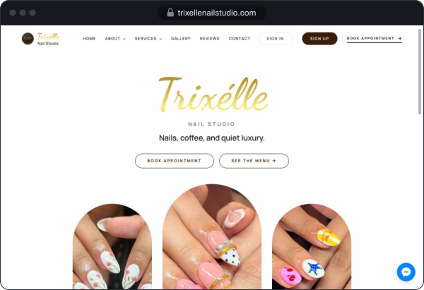</a><br /><sub>Trixélle&nbsp;Nail&nbsp;Studio&nbsp;·&nbsp;home&nbsp;page&nbsp;&nbsp;&nbsp;&nbsp;&nbsp;&nbsp;&nbsp;&nbsp;&nbsp;&nbsp;&nbsp;&nbsp;&nbsp;&nbsp;&nbsp;&nbsp;&nbsp;&nbsp;&nbsp;&nbsp;&nbsp;&nbsp;&nbsp;&nbsp;&nbsp;&nbsp;&nbsp;&nbsp;&nbsp;&nbsp;&nbsp;&nbsp;&nbsp;&nbsp;&nbsp;&nbsp;&nbsp;&nbsp;&nbsp;&nbsp;&nbsp;&nbsp;&nbsp;&nbsp;&nbsp;&nbsp;&nbsp;&nbsp;&nbsp;&nbsp;&nbsp;&nbsp;&nbsp;&nbsp;&nbsp;&nbsp;&nbsp;&nbsp;&nbsp;&nbsp;&nbsp;&nbsp;&nbsp;&nbsp;&nbsp;&nbsp;&nbsp;&nbsp;&nbsp;&nbsp;&nbsp;&nbsp;&nbsp;&nbsp;&nbsp;&nbsp;&nbsp;&nbsp;&nbsp;&nbsp;&nbsp;&nbsp;&nbsp;&nbsp;&nbsp;&nbsp;&nbsp;&nbsp;&nbsp;&nbsp;&nbsp;&nbsp;&nbsp;&nbsp;&nbsp;&nbsp;&nbsp;&nbsp;&nbsp;&nbsp;&nbsp;&nbsp;&nbsp;&nbsp;&nbsp;&nbsp;&nbsp;&nbsp;&nbsp;&nbsp;&nbsp;&nbsp;&nbsp;&nbsp;&nbsp;&nbsp;&nbsp;&nbsp;&nbsp;&nbsp;&nbsp;&nbsp;&nbsp;&nbsp;&nbsp;&nbsp;&nbsp;&nbsp;&nbsp;&nbsp;&nbsp;&nbsp;&nbsp;&nbsp;&nbsp;&nbsp;&nbsp;&nbsp;&nbsp;&nbsp;&nbsp;&nbsp;&nbsp;&nbsp;&nbsp;&nbsp;&nbsp;&nbsp;&nbsp;&nbsp;&nbsp;&nbsp;&nbsp;&nbsp;&nbsp;&nbsp;</sub></td>
    <td valign="top"><a href="https://www.trixellenailstudio.com/services">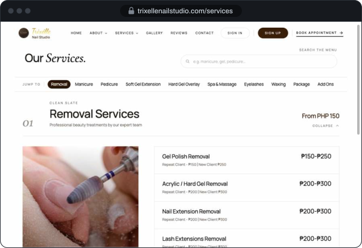</a><br /><sub>Trixélle&nbsp;Nail&nbsp;Studio&nbsp;·&nbsp;services&nbsp;&nbsp;&nbsp;&nbsp;&nbsp;&nbsp;&nbsp;&nbsp;&nbsp;&nbsp;&nbsp;&nbsp;&nbsp;&nbsp;&nbsp;&nbsp;&nbsp;&nbsp;&nbsp;&nbsp;&nbsp;&nbsp;&nbsp;&nbsp;&nbsp;&nbsp;&nbsp;&nbsp;&nbsp;&nbsp;&nbsp;&nbsp;&nbsp;&nbsp;&nbsp;&nbsp;&nbsp;&nbsp;&nbsp;&nbsp;&nbsp;&nbsp;&nbsp;&nbsp;&nbsp;&nbsp;&nbsp;&nbsp;&nbsp;&nbsp;&nbsp;&nbsp;&nbsp;&nbsp;&nbsp;&nbsp;&nbsp;&nbsp;&nbsp;&nbsp;&nbsp;&nbsp;&nbsp;&nbsp;&nbsp;&nbsp;&nbsp;&nbsp;&nbsp;&nbsp;&nbsp;&nbsp;&nbsp;&nbsp;&nbsp;&nbsp;&nbsp;&nbsp;&nbsp;&nbsp;&nbsp;&nbsp;&nbsp;&nbsp;&nbsp;&nbsp;&nbsp;&nbsp;&nbsp;&nbsp;&nbsp;&nbsp;&nbsp;&nbsp;&nbsp;&nbsp;&nbsp;&nbsp;&nbsp;&nbsp;&nbsp;&nbsp;&nbsp;&nbsp;&nbsp;&nbsp;&nbsp;&nbsp;&nbsp;&nbsp;&nbsp;&nbsp;&nbsp;&nbsp;&nbsp;&nbsp;&nbsp;&nbsp;&nbsp;&nbsp;&nbsp;&nbsp;&nbsp;&nbsp;&nbsp;&nbsp;&nbsp;&nbsp;&nbsp;&nbsp;&nbsp;&nbsp;&nbsp;&nbsp;&nbsp;&nbsp;&nbsp;&nbsp;&nbsp;&nbsp;&nbsp;&nbsp;&nbsp;&nbsp;&nbsp;&nbsp;&nbsp;&nbsp;&nbsp;&nbsp;&nbsp;&nbsp;&nbsp;&nbsp;&nbsp;&nbsp;&nbsp;&nbsp;&nbsp;&nbsp;</sub></td>
    <td valign="top"><a href="https://app-dev-blockchain-project.vercel.app">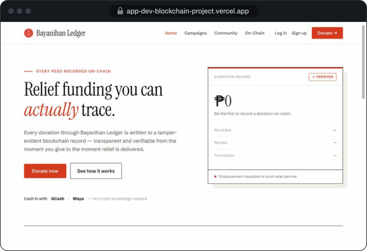</a><br /><sub>Bayanihan&nbsp;Ledger&nbsp;·&nbsp;live&nbsp;demo&nbsp;&nbsp;&nbsp;&nbsp;&nbsp;&nbsp;&nbsp;&nbsp;&nbsp;&nbsp;&nbsp;&nbsp;&nbsp;&nbsp;&nbsp;&nbsp;&nbsp;&nbsp;&nbsp;&nbsp;&nbsp;&nbsp;&nbsp;&nbsp;&nbsp;&nbsp;&nbsp;&nbsp;&nbsp;&nbsp;&nbsp;&nbsp;&nbsp;&nbsp;&nbsp;&nbsp;&nbsp;&nbsp;&nbsp;&nbsp;&nbsp;&nbsp;&nbsp;&nbsp;&nbsp;&nbsp;&nbsp;&nbsp;&nbsp;&nbsp;&nbsp;&nbsp;&nbsp;&nbsp;&nbsp;&nbsp;&nbsp;&nbsp;&nbsp;&nbsp;&nbsp;&nbsp;&nbsp;&nbsp;&nbsp;&nbsp;&nbsp;&nbsp;&nbsp;&nbsp;&nbsp;&nbsp;&nbsp;&nbsp;&nbsp;&nbsp;&nbsp;&nbsp;&nbsp;&nbsp;&nbsp;&nbsp;&nbsp;&nbsp;&nbsp;&nbsp;&nbsp;&nbsp;&nbsp;&nbsp;&nbsp;&nbsp;&nbsp;&nbsp;&nbsp;&nbsp;&nbsp;&nbsp;&nbsp;&nbsp;&nbsp;&nbsp;&nbsp;&nbsp;&nbsp;&nbsp;&nbsp;&nbsp;&nbsp;&nbsp;&nbsp;&nbsp;&nbsp;&nbsp;&nbsp;&nbsp;&nbsp;&nbsp;&nbsp;&nbsp;&nbsp;&nbsp;&nbsp;&nbsp;&nbsp;&nbsp;&nbsp;&nbsp;&nbsp;&nbsp;&nbsp;&nbsp;&nbsp;&nbsp;&nbsp;&nbsp;&nbsp;&nbsp;&nbsp;&nbsp;&nbsp;&nbsp;&nbsp;&nbsp;&nbsp;&nbsp;&nbsp;&nbsp;&nbsp;&nbsp;&nbsp;&nbsp;&nbsp;&nbsp;&nbsp;&nbsp;&nbsp;&nbsp;&nbsp;</sub></td>
  </tr>
</table>

Source for Bayanihan Ledger is in [AppDevBlockchainProject](https://github.com/ronaldajusan0/AppDevBlockchainProject).

## Experience

<details open>
<summary><b>Lead Developer, HeyPay</b> &nbsp;·&nbsp; Artisam Labs &nbsp;·&nbsp; Contract, Sep 28 to Oct 28, 2026</summary>
<br />

- Led development of HeyPay, a blockchain-based QR payment platform, and owned its architecture, feature work, and technical direction.
- Stayed on as lead developer under a one-month contract with Artisam Labs after HeyPay secured funding.
- Built full-stack features with Next.js, Node.js, TypeScript, PostgreSQL, and Prisma, integrated with the Stellar network and the Xendit payment platform.
- Used Claude and Claude skills for development, UI design, and AI-run end-to-end checks that return a screenshot of every issue found.
- Onboarded new users at Blockquest Fiesta in Cabuyao, Laguna, and at Asia Pacific College in Makati.

</details>

<details>
<summary><b>Quality Assurance Intern</b> &nbsp;·&nbsp; Artisam Labs</summary>
<br />

- Tested several Web3 projects for the company, starting with the team's own HeyPay.
- Wrote test cases and kept bug report files to document, track, and communicate defects.
- Ran test cases by hand on staging to check features against expected results.
- Automated test runs with Playwright, using AI-driven browser control on staging to capture screenshot evidence for each result.
- Used happy-path and regression testing to confirm core user flows and catch issues introduced by new changes.

</details>

<details>
<summary><b>Full-Stack Web Developer, Freelance</b> &nbsp;·&nbsp; Trixélle Nail Studio</summary>
<br />

- Built and maintain [trixellenailstudio.com](https://trixellenailstudio.com), a live booking and studio-management platform used by the studio's customers.
- Customers book appointments and pay the booking fee with PayMongo QR Ph. Staff manage appointments, clients, services, and payments.
- React, TypeScript, Node.js, Express, MongoDB, and Tailwind CSS, deployed on Vercel.

</details>

<details>
<summary><b>Other work</b> &nbsp;·&nbsp; school projects, data annotation, community</summary>
<br />

- **TUP Taguig coursework.** A PHP and MySQL website, MERN stack applications in JavaScript and TypeScript, a Laravel MVC site with a database, and algorithm work in C++.
- **Bignay Detection Project.** Annotated the image datasets used to train a model that detects bignay fruit.
- **Mobile and IoT.** Mobile apps with React Native and Expo Go, and ESP32 and Arduino builds.
- **Video.** I shoot, edit, and render short-form videos and post them on [TikTok](https://www.tiktok.com/@ronaldajusan).
- **Discord.** Trainer and community helper: trained players and helped community members.

</details>

## Events and recognition

Where I've presented HeyPay and onboarded its users. Select a pin for details.

```geojson
{
  "type": "FeatureCollection",
  "features": [
    {
      "type": "Feature",
      "properties": { "name": "SMX Convention Center, Pasay", "event": "Builder Showcase × WOCEE 2026: presented HeyPay on stage", "marker-color": "#0969da" },
      "geometry": { "type": "Point", "coordinates": [120.98158, 14.53203] }
    },
    {
      "type": "Feature",
      "properties": { "name": "Asia Pacific College, Makati", "event": "Onboarded new HeyPay users", "marker-color": "#0969da" },
      "geometry": { "type": "Point", "coordinates": [121.02143, 14.53105] }
    },
    {
      "type": "Feature",
      "properties": { "name": "Blockquest Fiesta, Cabuyao, Laguna", "event": "Onboarded new HeyPay users at the Artisam Labs booth", "marker-color": "#0969da" },
      "geometry": { "type": "Point", "coordinates": [121.12348, 14.28015] }
    },
    {
      "type": "Feature",
      "properties": { "name": "TUP Taguig", "event": "Home campus. MTICS IT Seminar with Gen AI Philippines, 2025", "marker-color": "#59636e" },
      "geometry": { "type": "Point", "coordinates": [121.03588, 14.50981] }
    }
  ]
}
```

**Asia Pacific College**, Makati · onboarding new HeyPay users

<p>
  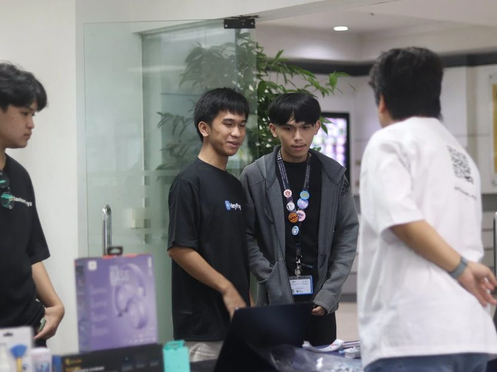
  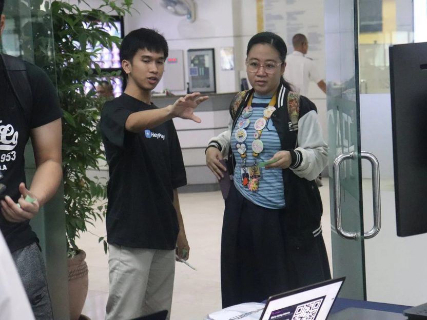
</p>

**Blockquest Fiesta**, Cabuyao, Laguna · onboarding users at the Artisam Labs booth

<p>
  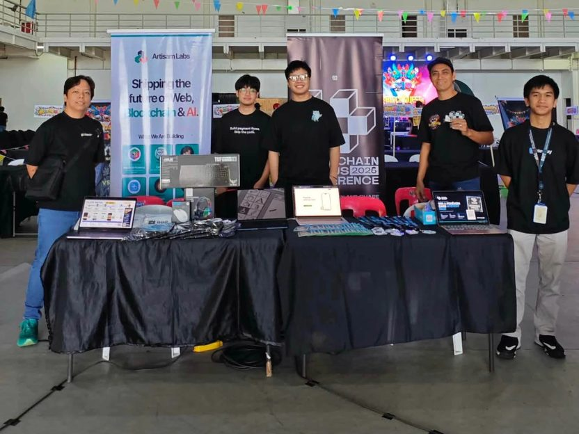
  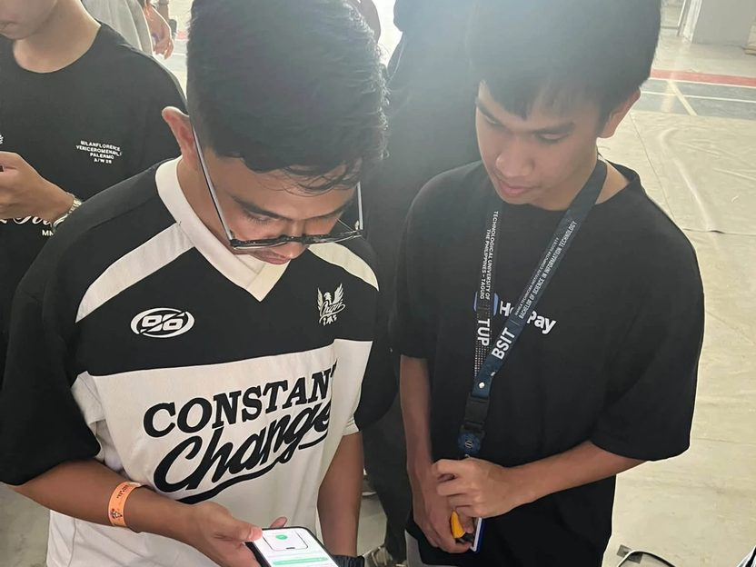
</p>

**Builder Showcase × WOCEE 2026**, SMX Convention Center · presenting HeyPay

<p>
  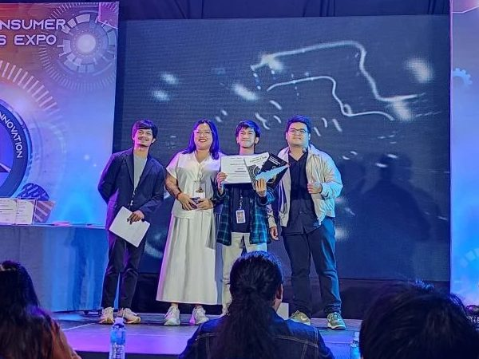
  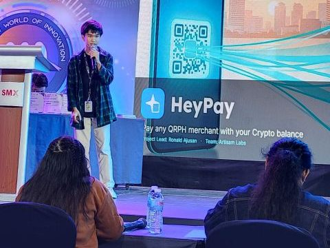
</p>

**StellarX Demo Day 3** · StellarX PH Roadshow

<p>
  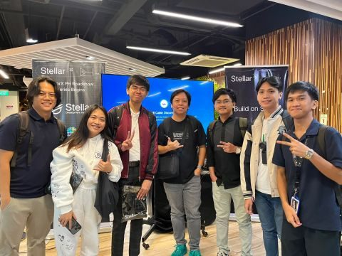
  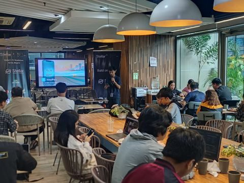
</p>

| Year | Highlight |
| :--- | :--- |
| 2026 | Presented a blockchain-based Web3 project at **StellarX Demo Day** |
| 2026 | Built on the Stellar ecosystem at the **Stellar APAC Hackathon** |
| 2026 | Showed project work at **Builder Showcase × WOCEE 2026**, SMX Convention Center |
| 2025 | Published *Iris Scanning: An Evaluation of Data Privacy and Security in World App's Biometric System* |
| 2025 | **FIRST MOVE: TUP Taguig at BLOCKSPACE**, Makati City |
| 2025 | **MTICS IT Seminar** with Gen AI Philippines, TUP Taguig |
| 2023 | **Academic Excellence**, With Honors |

## Stack

| Area | Tools |
| :--- | :--- |
| Languages | TypeScript, JavaScript, PHP, C++, Python, Java, Visual Basic, SQL, HTML, CSS |
| Web | React, Next.js, Vite, Node.js, Express, Laravel (MVC), REST APIs, Tailwind CSS, Bootstrap |
| Mobile | React Native, Expo Go, Android Studio |
| Data | PostgreSQL, MySQL, MongoDB, SQLite, Prisma, Mongoose, Supabase, Firebase |
| Payments and Web3 | Stellar SDK, Soroban smart contracts (fundamentals), custodial wallets, on-chain transactions, DEX and path payments, PayMongo, Xendit, Ethereum, Solidity |
| Testing | Playwright automation, end-to-end, regression and happy-path testing, manual testing on staging, test cases, bug reports |
| Security | JWT authentication, role-based access control, password hashing, Helmet, CORS, rate limiting, input validation, NoSQL injection prevention |
| Deploy and infrastructure | Vercel, Cloudinary, Cloudflare DNS, Namecheap, Linux and Windows installation and setup, basic server configuration |
| AI | Claude and Claude skills, OpenAI API, image dataset annotation |
| Hardware | ESP32, Arduino |
| Tools | Git, GitHub, VS Code, Figma, CapCut |

## Contact

Open to roles and projects in AI, blockchain, and cybersecurity. The fastest way to reach me is [ronaldajusan0@gmail.com](mailto:ronaldajusan0@gmail.com). I'm also on [LinkedIn](https://www.linkedin.com/in/ronald-ajusan-251109371), [Facebook](https://www.facebook.com/ronaldong.ajusan), and [TikTok](https://www.tiktok.com/@ronaldajusan).
